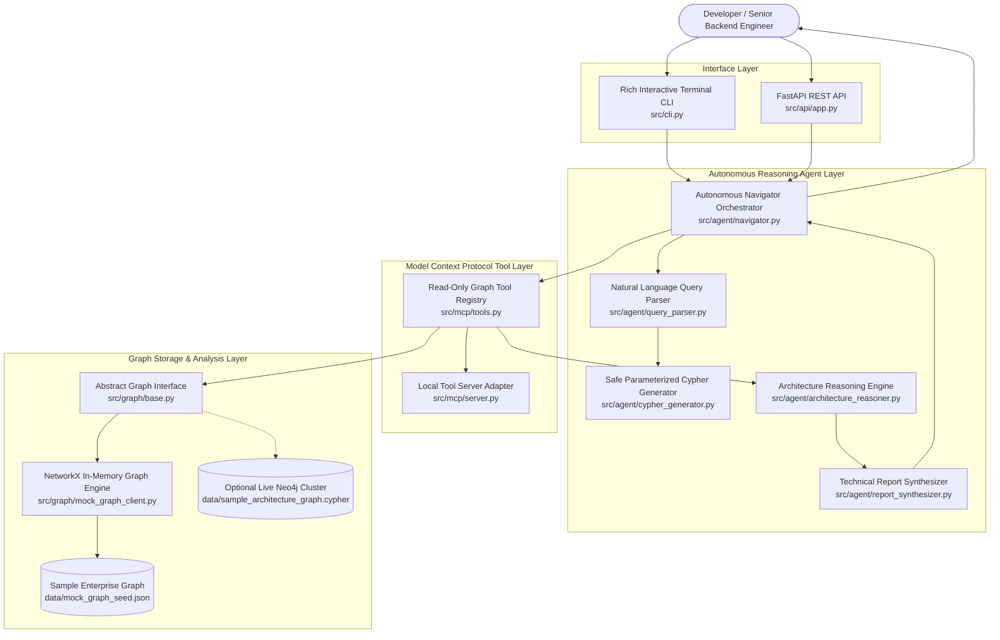

# Adiveppa G41-AIML

---

# Task 2: Autonomous Codebase Knowledge Graph Navigator

## Project Overview

The **Autonomous Codebase Knowledge Graph Navigator** is an AI-assisted architecture analysis application designed to help developers understand software architecture, explore dependencies, identify circular dependencies, and assess the potential impact of architectural changes.

The application combines a Python-based graph analysis backend with a React-based interactive dashboard.

It allows users to ask architecture-related questions in natural language and receive structured analysis reports.

## Objectives

- Understand relationships between architecture components.
- Identify direct and indirect dependencies.
- Analyze the blast radius of architectural components.
- Detect circular dependencies.
- Explore architectural coupling and potential risks.
- Generate structured architecture analysis reports.
- Provide an interactive dashboard for architecture exploration.

## Technologies Used

| Category | Technologies |
|---|---|
| Programming Language | Python, JavaScript |
| Backend | FastAPI |
| Frontend | React.js |
| Frontend Build Tool | Vite |
| Graph Analysis | NetworkX |
| API Communication | REST API |
| Data Format | JSON |
| Styling | CSS |
| Testing | Pytest |

## System Architecture

The project consists of the following components:

### 1. Graph Analysis Backend

The backend represents architecture components and their dependencies using a graph structure.

It supports:
- Architecture graph exploration
- Dependency analysis
- Circular dependency detection
- Blast-radius analysis
- Component information retrieval

### 2. Natural Language Architecture Navigator

Users can submit questions such as:

- What is the blast radius of `legacy-auth-module`?
- Which circular dependencies exist?
- Which services depend on `order-service`?
- What happens if a component is deprecated?

The navigator processes the query and returns an architecture analysis report using the existing graph analysis backend.

### 3. React Dashboard

The frontend provides an interactive architecture assistant interface.

Features include:
- Architecture dashboard
- AI Architecture Chat interface
- Natural-language question input
- Blast-radius analysis
- Circular dependency exploration
- Architecture component browsing
- Analysis report display
- Suggested architecture questions
- Report history
- Copy and Markdown download options
- Responsive interface

## Key Features

### Architecture Graph Analysis

The system uses a sample architecture graph containing components and relationships.

Current sample graph:
- 22 nodes
- 35 relationships
- 7 node categories

### Blast-Radius Analysis

The system identifies components affected by changes to a selected architecture component.

Example:

For `legacy-auth-module`, the sample graph reports:
- 15 downstream affected components
- 5 direct dependents
- 10 indirect dependents

These values are based on the demonstration graph.

### Circular Dependency Detection

The graph analysis identifies circular dependency patterns.

Example cycles in the sample architecture:

1. `inventory-service → order-service → inventory-service`
2. `inventory-service → order-service → route-inventory-reserve → inventory-service`

### Natural-Language Architecture Chat

The chat interface allows users to ask questions about architecture dependencies and risks.

It sends queries to the FastAPI backend and displays the returned analysis report.

### Architecture Reports

The application generates structured reports containing architecture analysis results, affected components, and relevant findings.

## Project Structure

```text
Task 2 - Autonomous Codebase Knowledge Graph Navigator/
Γöé
Γö£ΓöÇΓöÇ data/
Γöé   ΓööΓöÇΓöÇ mock_graph_seed.json
Γöé
Γö£ΓöÇΓöÇ src/
Γöé   Γö£ΓöÇΓöÇ api/
Γöé   Γöé   ΓööΓöÇΓöÇ app.py
Γöé   Γö£ΓöÇΓöÇ agent/
Γöé   Γöé   ΓööΓöÇΓöÇ navigator.py
Γöé   Γö£ΓöÇΓöÇ graph/
Γöé   Γö£ΓöÇΓöÇ tools/
Γöé   ΓööΓöÇΓöÇ cli.py
Γöé
Γö£ΓöÇΓöÇ tests/
Γöé
Γö£ΓöÇΓöÇ frontend/
Γöé   Γö£ΓöÇΓöÇ src/
Γöé   Γöé   Γö£ΓöÇΓöÇ App.jsx
Γöé   Γöé   Γö£ΓöÇΓöÇ api.js
Γöé   Γöé   Γö£ΓöÇΓöÇ main.jsx
Γöé   Γöé   ΓööΓöÇΓöÇ styles.css
Γöé   Γö£ΓöÇΓöÇ index.html
Γöé   Γö£ΓöÇΓöÇ package.json
Γöé   ΓööΓöÇΓöÇ vite.config.js
Γöé
Γö£ΓöÇΓöÇ README.md
ΓööΓöÇΓöÇ requirements.txt
```

*The structure above summarizes the main project components.*

## Installation and Setup

### Prerequisites

- Python 3.10+
- Node.js and npm

### Backend Setup

Navigate to the project directory:

```bash
cd "Task 2 - Autonomous Codebase Knowledge Graph Navigator"
```

Install Python dependencies:

```bash
pip install -r requirements.txt
```

Start the backend:

```bash
python -m uvicorn src.api.app:app --reload
```

Backend API:

```text
http://127.0.0.1:8000
```

API documentation:

```text
http://127.0.0.1:8000/docs
```

### Frontend Setup

Open another terminal:

```bash
cd frontend
```

Install dependencies:

```bash
npm install
```

Start the frontend:

```bash
npm run dev
```

Frontend:

```text
http://localhost:5173
```

Ensure the backend is running before using architecture analysis features.

## API Endpoints

| Endpoint | Purpose |
|---|---|
| `GET /health` | Check backend health |
| `GET /schema` | Retrieve graph schema information |
| `GET /nodes` | List architecture nodes |
| `GET /nodes/{node_id}` | Retrieve component details |
| `GET /cycles` | Detect circular dependencies |
| `POST /blast-radius` | Analyze component blast radius |
| `POST /navigate` | Process natural-language architecture queries |

## Testing and Validation

The project has undergone backend and frontend validation.

Completed checks include:
- Backend API testing
- Graph analysis testing
- Blast-radius verification
- Circular dependency verification
- Natural-language navigation testing
- Frontend production build
- API communication verification

The backend test suite previously reported **63 passing tests**. Additional targeted API tests reported **8 passing tests**.

The frontend production build completed successfully using:

```bash
npm run build
```

## Current Implementation Status

**Important:** This project currently uses a local mock architecture graph for demonstration and analysis.

The current implementation includes:
- NetworkX-based graph analysis
- Deterministic natural-language query processing
- Generated Cypher query representations
- A local JSON-RPC-style tool adapter
- FastAPI endpoints
- React frontend integration

The current version does **not** execute queries against a live Neo4j database and does not include a fully integrated external LLM or official MCP server connection.

These integrations remain potential future enhancements.

## Future Enhancements

- Integrate a real Neo4j architecture database.
- Implement an official MCP server and tool integration.
- Add LLM-powered natural-language reasoning.
- Improve architecture graph visualization.
- Support importing real codebase architecture data.
- Enhance dependency and risk analysis.
- Add automated architecture recommendations.

## Conclusion

The Autonomous Codebase Knowledge Graph Navigator demonstrates how graph-based architecture analysis, backend APIs, and an interactive frontend can be combined to explore software dependencies and architectural risks.

The project provides a foundation for developing more advanced AI-driven architecture intelligence tools.

---

**Developed as part of my AI/ML internship project work.**
# Autonomous Codebase Knowledge Graph Navigator

**Internship Scope:** G41 – AI/ML  
**Task:** Task 2 – Autonomous Codebase Knowledge Graph Navigator  
**Working Directory:** `Mentee Contribution/G41 - AI ML/Task 2 - Autonomous Codebase Knowledge Graph Navigator`  
**Python Compatibility:** Python 3.10.11  
**Test Suite:** 63 / 63 tests passing (100% pass rate)

---

## 1. Problem Statement & Background

In large-scale enterprise microservice environments, progressive architectural decay and tight inter-service coupling frequently lead to unpredictable cascading failures when legacy modules are updated or deprecated. Developers often lack the graph query expertise to explore underlying knowledge graphs and accurately determine the blast radius of proposed refactoring actions.

This project delivers an **Autonomous Codebase Knowledge Graph Navigator** — a multi-step reasoning agent architecture that bridges human developer intent (natural language) and graph traversal. The system deterministically maps developer questions into parameterized, read-only Cypher queries, calculates exact blast-radius cascades, assesses architectural debt (coupling metrics, circular dependencies, shared datastores), and synthesizes actionable refactoring roadmaps for senior backend engineers.

---

## 2. System Architecture

The following diagram illustrates the multi-step reasoning and execution pipeline:



---

## 3. Core Component Breakdown

| Module | File | Responsibilities |
| :--- | :--- | :--- |
| **Config** | `src/config.py` | Pydantic Settings supporting environment variable overrides (`.env`), graph engine mode, and port configuration. |
| **Graph Storage** | `src/graph/base.py`<br/>`src/graph/mock_graph_client.py`<br/>`src/graph/schema.py` | In-memory NetworkX directed graph engine. Loads `mock_graph_seed.json`, verifies referential integrity, calculates direct/transitive blast radius (excluding source), detects cycles, and extracts schema statistics. Guarantees graph immutability during analysis. |
| **MCP Tool Layer** | `src/mcp/tools.py`<br/>`src/mcp/server.py` | Exposes 6 read-only tools (`get_graph_schema`, `search_graph_nodes`, `get_node_dependencies`, `analyze_blast_radius`, `detect_dependency_cycles`, `analyze_coupling`). Prohibits mutating operations (`CREATE`, `DELETE`, `SET`, `DROP`). Includes a transport-independent JSON-RPC 2.0 tool server adapter. |
| **Query Parser** | `src/agent/query_parser.py` | Normalizes casing and whitespace, resolves category synonyms (`db` $\rightarrow$ `Database`, `services` $\rightarrow$ `Microservice`), extracts verified node IDs, and identifies canonical intents (`BLAST_RADIUS`, `GET_SCHEMA`, `SEARCH_NODES`, `DETECT_CYCLES`, `ANALYZE_COUPLING`). |
| **Cypher Generator** | `src/agent/cypher_generator.py` | Generates safe, parameterized Cypher templates (`$node_id`, `$search_term`, `$category`). Prevents string interpolation injections, enforces read-only safety, and documents that Cypher is generated for future Neo4j integration without pretending it was executed. |
| **Reasoning Engine** | `src/agent/architecture_reasoner.py` | Evaluates blast-radius impact, traces shortest dependency paths, detects cycles (`order-service` $\longleftrightarrow$ `inventory-service`), identifies shared datastore anti-patterns (`shared-customer-db`), and produces calibrated, evidence-backed architectural risks (`LOW`, `MEDIUM`, `HIGH`). |
| **Report Synthesizer** | `src/agent/report_synthesizer.py` | Compiles raw graph facts and reasoning findings into GitHub-flavored Markdown reports with exact microservice/route tables, debt evaluations, phased refactoring roadmaps, and Mermaid diagrams. |
| **Orchestrator** | `src/agent/navigator.py` | Unified coordinator integrating parser, Cypher generator, tool registry, reasoner, and synthesizer into a single `navigate(query)` workflow. |
| **REST Interface** | `src/api/app.py` | FastAPI application exposing `/health`, `/schema`, `/nodes`, `/nodes/{id}`, `/cycles`, `/blast-radius`, and `/navigate` endpoints. |
| **Terminal CLI** | `src/cli.py` | Interactive terminal interface utilizing `rich` tables, panels, and syntax-highlighted Markdown rendering. |

---

## 4. Fictional Enterprise Architecture Dataset

The sample graph dataset in [`data/mock_graph_seed.json`](data/mock_graph_seed.json) and [`data/sample_architecture_graph.cypher`](data/sample_architecture_graph.cypher) models a realistic multi-tier commerce architecture:

* **Total Nodes:** 22 components
* **Total Edges:** 35 relationships
* **Node Categories (7):**
  1. **Frontend components (3):** `web-portal`, `mobile-app`, `admin-console`
  2. **API gateway (1):** `edge-api-gateway`
  3. **API routes (6):** `/api/v1/auth/login`, `/api/v1/auth/verify`, `/api/v1/orders/checkout`, `/api/v1/payments/charge`, `/api/v1/inventory/reserve`, `/api/v1/users/profile`
  4. **Microservices (6):** `auth-service`, `order-service`, `payment-service`, `inventory-service`, `user-service`, `notification-service`
  5. **Shared modules (2):** `legacy-auth-module`, `common-logger-lib`
  6. **Databases (3):** `shared-customer-db` (PostgreSQL), `order-document-db` (MongoDB), `inventory-sql-db` (PostgreSQL)
  7. **Caches (1):** `shared-session-cache` (Redis)
* **Relationship Types (5):** `CALLS`, `DEPENDS_ON`, `USES`, `CONNECTS_TO`, `AUTHENTICATES_WITH`

---

## 5. Walkthrough: Deprecating `legacy-auth-module`

### 5.1 Developer Inquiry
```text
"If I deprecate the legacy authentication module, which downstream API routes and frontend components will break?"
```

### 5.2 Agent Execution Lifecycle
1. **Query Intent:** Parsed as `QueryIntent.BLAST_RADIUS` with target entity `legacy-auth-module`.
2. **Parameterized Cypher Generation:**
   ```cypher
   MATCH path = (dependent)-[:CALLS|DEPENDS_ON|USES|AUTHENTICATES_WITH|CONNECTS_TO*1..5]->(target {id: $node_id})
   WHERE dependent.id <> $node_id
   RETURN dependent.id AS affected_node_id, dependent.type AS affected_type,
          dependent.name AS affected_name, length(path) AS dependency_depth
   ORDER BY dependency_depth ASC, affected_node_id ASC
   ```
   *Parameters:* `{"node_id": "legacy-auth-module"}`
3. **Graph Retrieval & Reasoning:**
   * **Blast Radius Count:** Exactly **15 downstream components** (`starting_node_included: False`).
   * **Direct Dependents (5):** `edge-api-gateway`, `auth-service`, `order-service`, `payment-service`, `user-service`.
   * **Affected Microservices (5):** `auth-service`, `order-service`, `payment-service`, `inventory-service`, `user-service`.
   * **Affected API Routes (6):** `route-auth-login`, `route-auth-verify`, `route-orders-checkout`, `route-payments-charge`, `route-inventory-reserve`, `route-user-profile`.
   * **Affected Frontend Apps (3):** `web-portal`, `mobile-app`, `admin-console`.
   * **Coupling Metrics:** Afferent Coupling $C_a = 5$, Efferent Coupling $C_e = 0$, Instability $I = 0.0$ $\rightarrow$ **Potential Failure Concentration Risk** (structural failure concentration based on in-degree; runtime clustering/redundancy requires operational verification).
   * **Architectural Debt Identified:**
     * High inbound coupling at edge gateway and core domain services.
     * Circular dependency between `order-service` and `inventory-service`.
     * Shared database anti-pattern: `shared-customer-db` directly accessed by both `auth-service` and `user-service`.
4. **Actionable Refactoring Roadmap:**
   * **Phase 1 (Ingress Isolation):** Introduce Anti-Corruption Layer (ACL) facade on `edge-api-gateway` with feature flags and canary routing.
   * **Phase 2 (Service Decoupling):** Replace synchronous token validation with decentralized public-key JWKS validation; break `order-service` <-> `inventory-service` cycle using the Saga pattern.
   * **Phase 3 (Storage Boundary Isolation):** Enforce Database-per-Service boundaries for `shared-customer-db` by encapsulating queries behind an internal user service API.
   * **Phase 4 (Decommissioning):** Monitor traffic to ensure 0 RPM over a 14-day bake period, archive legacy route handlers, and decommission module.

---

## 6. Verification & Test Suite

The test suite validates every layer of the architecture without requiring external network calls or paid API tokens:

```powershell
$env:PYTHONPATH="Mentee Contribution\G41 - AI ML\Task 2 - Autonomous Codebase Knowledge Graph Navigator"
python -m pytest "Mentee Contribution/G41 - AI ML/Task 2 - Autonomous Codebase Knowledge Graph Navigator/tests" -v
```

### Test Breakdown (63 Tests Total):
* **`tests/test_graph_clients.py` (9 tests):** JSON loading, unique IDs, referential integrity, direct/transitive traversal, cycle detection, coupling metrics, unknown node handling, and graph immutability.
* **`tests/test_mcp_tools.py` (11 tests):** Tool registration, schema inspection, node search, blast radius, cycle detection, coupling tools, argument validation, read-only security checks, and JSON-RPC dispatching.
* **`tests/test_query_parser.py` (7 tests):** Intent parsing, casing/whitespace normalization, synonym resolution, node ID extraction, unknown node handling, and JSON serialization.
* **`tests/test_cypher_generator.py` (10 tests):** Cypher parameterization, read-only security enforcement, source-node exclusion in WHERE clause, schema validation, and execution note disclosures.
* **`tests/test_architecture_reasoner.py` (11 tests):** Blast-radius reasoning, dependency paths, cycle explanations, coupling analysis, shared dependency detection, evidence-backed risk generation, recommendation grounding, deterministic output, and sample source disclosure.
* **`tests/test_report_synthesis.py` (7 tests):** Report section completeness, contextual grounding (zero hallucinations), end-to-end navigator execution of the core problem statement, cycle queries, coupling queries, and JSON serialization.
* **`tests/test_api.py` (8 tests):** FastAPI endpoints (`/health`, `/schema`, `/nodes`, `/nodes/{id}`, `/cycles`, `/blast-radius`, `/navigate`, and 400 error handling).

---

## 7. Execution Guide

### 7.1 Running the Interactive Terminal CLI
```powershell
# Interactive REPL mode
python "Mentee Contribution/G41 - AI ML/Task 2 - Autonomous Codebase Knowledge Graph Navigator/src/cli.py"

# Direct query mode
python "Mentee Contribution/G41 - AI ML/Task 2 - Autonomous Codebase Knowledge Graph Navigator/src/cli.py" --query "If I deprecate the legacy authentication module, which downstream API routes and frontend components will break?"

# Inspect graph schema
python "Mentee Contribution/G41 - AI ML/Task 2 - Autonomous Codebase Knowledge Graph Navigator/src/cli.py" --schema

# Detect circular dependencies
python "Mentee Contribution/G41 - AI ML/Task 2 - Autonomous Codebase Knowledge Graph Navigator/src/cli.py" --cycles
```

> **Current integration limitation:** The JSON-RPC implementation is a local, transport-independent adapter that is not the official MCP SDK server implementation and does not provide network transport support. The project currently operates offline using the NetworkX mock graph and does not execute generated Cypher against Neo4j.

### 7.2 Starting the FastAPI REST API
```powershell
uvicorn src.api.app:app --host 127.0.0.1 --port 8000 --reload
```
Interactive OpenAPI Swagger docs will be accessible at:  
`http://127.0.0.1:8000/docs`

### 7.3 Importing into a Live Neo4j Cluster (Optional)
To load this enterprise microservice graph into a local or cloud Neo4j instance:
1. Open Neo4j Browser or Cypher Shell.
2. Execute the statements in [`data/sample_architecture_graph.cypher`](data/sample_architecture_graph.cypher).
3. Update `.env` with your `NEO4J_URI`, `NEO4J_USERNAME`, and `NEO4J_PASSWORD`.

---

## 8. Strict Scope & Integrity Compliance

* **Preserved:** [`task-info.md`](task-info.md) remains 100% untouched.
* **Workspace Isolation:** All work was confined strictly to `Mentee Contribution/G41 - AI ML/Task 2 - Autonomous Codebase Knowledge Graph Navigator`.
* **Zero External Dependencies Required:** System operates 100% offline using deterministic NetworkX graph analysis and template-based reasoning.
* **No Commits/Pushes:** Repository working tree remains uncommitted for review.
